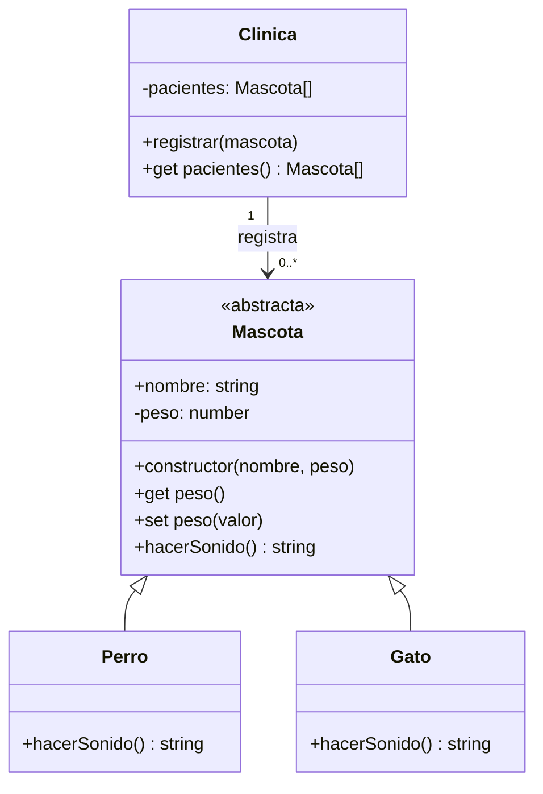

# Vet Turnos

Aplicación web sencilla para registrar pacientes de una clínica veterinaria. El proyecto también sirve como ejemplo de programación orientada a objetos en JavaScript: abstracción, encapsulamiento, herencia y polimorfismo.

## Contenido

- [Funcionalidades](#funcionalidades)
- [Estructura del proyecto](#estructura-del-proyecto)
- [Ejecución](#ejecución)
- [Modelo orientado a objetos](#modelo-orientado-a-objetos)
  - [Abstracción](#abstracción)
  - [Encapsulamiento](#encapsulamiento)
  - [Herencia y polimorfismo](#herencia-y-polimorfismo)
  - [Diagrama de clases](#diagrama-de-clases)

## Funcionalidades

- Registrar una mascota seleccionando **Perro** o **Gato** e ingresando su nombre y peso.
- Validar que el peso sea un número mayor que cero mediante el setter de `Mascota`.
- Mostrar los pacientes registrados, su tipo, nombre, peso y el sonido correspondiente.
- Mostrar el total de pacientes y mensajes de registro correcto o de error.
- Mantener los pacientes en memoria durante la sesión de la página. No hay persistencia en una base de datos.

La aplicación registra pacientes; no implementa agenda ni asignación de turnos.

## Estructura del proyecto

| Ruta | Descripción |
|---|---|
| `index.html` | Página principal. Contiene el formulario y los elementos donde se muestran los mensajes, la lista y el total. Carga `estilos.css` y `abs.js`. |
| `estilos.css` | Reglas de presentación de la página. |
| `abs.js` | Implementación activa: modelo de mascotas con abstracción y encapsulamiento, clase `Clinica` y lógica de interacción con el formulario. |
| `programa.js` | Variante alternativa con abstracción y herencia, sin el encapsulamiento ni la clase `Clinica` de `abs.js`. No se carga desde `index.html`. |
| `img/10. Abstracción en Vet Turnos.html` | Documento de referencia con un diagrama SVG sobre abstracción, contrato y clases concretas. |
| `img/Abstracción y encapsulamiento en Vet Turnos.html` | Documento de referencia con diagramas SVG de abstracción, encapsulamiento y clases. |
| `LICENSE` | Licencia del proyecto. |

Los diagramas SVG están dentro de documentos HTML, no son archivos de imagen independientes. Los diagramas de este README están escritos en Mermaid, compatible con GitHub, y los HTML originales se enlazan como material de referencia:

- [Diagrama original de abstracción]()
- [Diagramas originales de abstracción y encapsulamiento]()

## Ejecución

Abre `index.html` en un navegador moderno. No se requiere instalación de dependencias ni un servidor para la demostración básica.

El HTML incluye `abs.js` como script activo. Para usar la variante alternativa `programa.js`, habría que cambiar manualmente el `<script>` de `index.html`; no se cargan ambas implementaciones a la vez.

## Modelo orientado a objetos

### Abstracción

`Mascota` define los datos y el contrato que comparten los tipos de mascota. No se permite crear directamente una instancia de esa clase: su constructor comprueba `new.target`. Además, `hacerSonido()` lanza un error si una subclase no lo sobrescribe.

En la implementación activa, `Perro` y `Gato` extienden `Mascota` y proporcionan su propio sonido. El HTML de referencia [10. Abstracción en Vet Turnos]() muestra el contrato y cómo la lista utiliza el método sin necesitar lógica específica para cada tipo.

```js
class Perro extends Mascota {
    hacerSonido() {
        return "Guau Guau";
    }
}

class Gato extends Mascota {
    hacerSonido() {
        return "Miau Miau";
    }
}
```

### Encapsulamiento

En `abs.js`, `Mascota` almacena el peso en el campo privado `#peso`. El código externo accede a ese valor a través de `peso`; el setter rechaza valores que no sean numéricos, positivos y distintos de `NaN`.

`Clinica` protege su arreglo `#pacientes`. `registrar(mascota)` comprueba que el argumento sea una instancia de `Mascota`, y el getter `pacientes` devuelve una copia del arreglo, no el estado interno.

```js
class Clinica {
    #pacientes = [];

    registrar(mascota) {
        if (!(mascota instanceof Mascota)) {
            throw new TypeError("Solo se pueden registrar mascotas");
        }
        this.#pacientes.push(mascota);
    }

    get pacientes() {
        return [...this.#pacientes];
    }
}
```

El diagrama SVG original que desarrolla estas dos ideas está en [Abstracción y encapsulamiento en Vet Turnos]().

### Herencia y polimorfismo

- **Herencia:** `Perro` y `Gato` reutilizan el constructor, `nombre` y la interfaz de `Mascota` mediante `extends`.
- **Polimorfismo:** `dibujar()` recorre los pacientes y llama a `m.hacerSonido()`. La implementación ejecutada depende de si el objeto es un `Perro` o un `Gato`, sin que `dibujar()` tenga que elegir el sonido.

### Diagrama de clases



En el diagrama, `-peso` y `-pacientes` representan los campos privados de JavaScript `#peso` y `#pacientes`. `Mascota` es abstracta por convención y comprobaciones de ejecución: JavaScript no tiene una palabra clave `abstract` para clases.

## Autor

[roazapatayensi-hue](https://github.com/roazapatayensi-hue) — [276148266+roazapatayensi-hue@users.noreply.github.com](mailto:276148266+roazapatayensi-hue@users.noreply.github.com)
